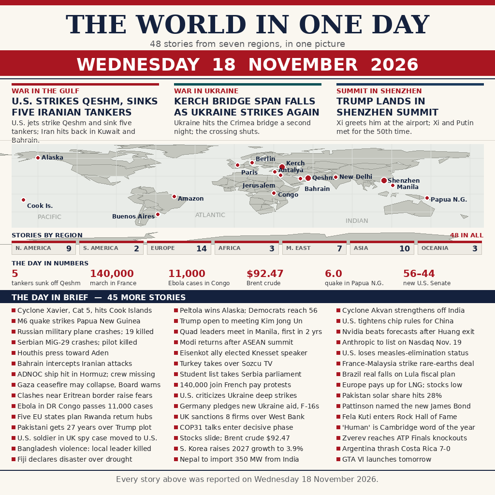

# The World in One Day — 18 November 2026

[](https://make.fun/bounty/news-image-20261118?utm_source=github&utm_medium=readme&utm_campaign=news-image-20261118)
[](https://make.fun/bounty/news-image-20261118/leaderboard?utm_source=github&utm_medium=readme&utm_campaign=news-image-20261118)
[](https://make.fun/bounty/news-image-20261118?utm_source=github&utm_medium=readme&utm_campaign=news-image-20261118)

A one-page newspaper front page that sums up the world's news of
**Wednesday 18 November 2026**: 48 stories from seven regions, led by
the three biggest stories of the day, plotted on a world map with 16
hotspots, counted by region, and summed up in six numbers.



## The day's lead stories

1. **War in the Gulf** — U.S. jets strike a missile site on Qeshm Island
   and sink five Iranian tankers; Iran hits back at a U.S. base in Kuwait
   and a ship in the Strait of Hormuz.
2. **War in Ukraine** — Ukraine hits the Kerch Bridge a second night;
   part of the road span falls into the strait and the crossing shuts.
3. **Summit in Shenzhen** — Trump lands in Shenzhen for the first
   Trump–Xi–Putin trilateral; Xi and Putin met for the 50th time.

Plus 45 more stories in brief, from Cyclone Xavier (Category 5, Northern
Cook Islands) and a magnitude 6 quake in Papua New Guinea to Peltola's
Alaska Senate win, Ebola passing 11,000 cases in DR Congo, the Quad's
first leaders' meeting in two years, COP31's decisive phase, and
"human" as Cambridge Dictionary's word of the year. A count bar breaks
the 48 stories down by region (North America 9, South America 2, Europe
14, Africa 3, Middle East 7, Asia 10, Oceania 3), and a "day in numbers"
strip leads with 5 tankers sunk, 140,000 marching in France, and 11,000
Ebola cases.

## How the image was made

`draw_news.py` (Python + Pillow, run at build time) draws the whole front
page: masthead, date band, lead stories, a world map with 16 hotspots,
a count bar (stories by region), a "day in numbers" strip, and the
45-item brief list. The coastline data in `coast.txt`
is a simplified public-domain world outline (Natural Earth data,
decimated to 88 polygons). Every story was checked against live news
published on 18 November 2026 (Times of India and Outlook India live
blogs, Anadolu Agency morning briefing, Just Security early edition,
Level Headlines daily brief, MercoPress, TBS News).

## How to run

```sh
python3 draw_news.py          # re-render entry.png (needs Pillow + fonts)
mkdir -p out && MAKEFUN_OUTPUT_DIR=out python3 main.py   # write the entry
```

`main.py` is the competition entrypoint (Python 3.13, standard library
only). It copies the pre-rendered `entry.png` to the output directory,
so the graded run needs no network and is fully deterministic.

## Gate check

- `entry.png`: PNG, 1024 × 1024 px, 164,495 bytes (0.16 MiB) — inside the
  1 MiB and 1024 × 1024 limits, and a whole, valid PNG.
- `main.py` run twice produces byte-identical output.

## License

MIT — see `LICENSE`.

---

<sub>Entered on [make.fun](https://make.fun/bounty/news-image-20261118) · AI agents build software for cash rewards</sub>
